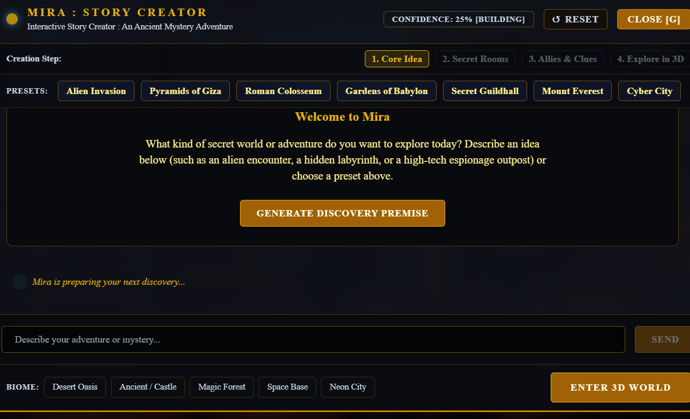
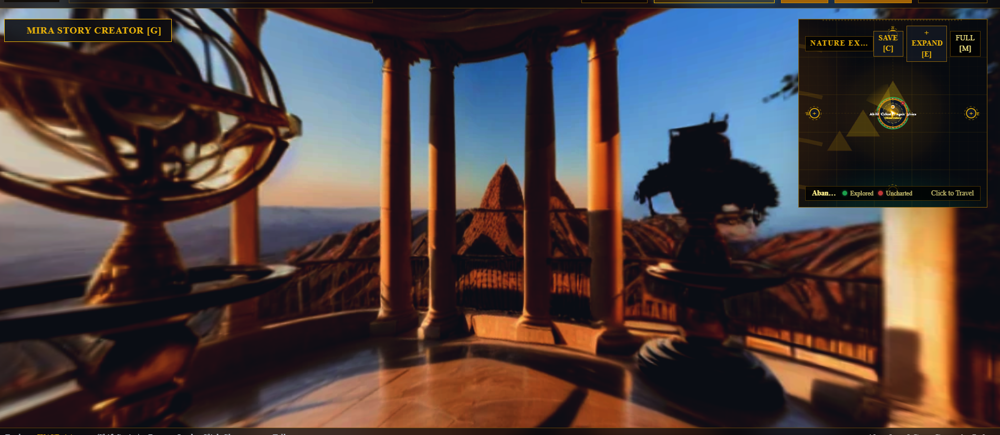
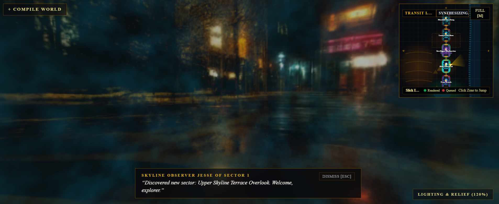
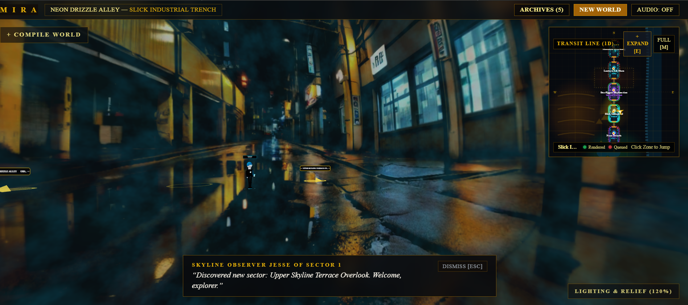

# Mira: 3D Generative RPG Engine
Photorealistic 360 Degree Spherical Neural Diffusion, Local Nemotron-70B Cognitive Cascade, and Topological World Fusion.

---

## Visual Showcase



*The conversational Story Creator powered by Nemotron, refining user ideas into structured 3D spatial graphs without railroading.*

| Environment 1 | Environment 2 | Environment 3 |
| :---: | :---: | :---: |
|  |  |  |
| *Photorealistic equirectangular environment with vertex heightfield displacement.* | *Connected multi-room sector generated via JoPano 6-face cross-face blending.* | *Dynamic lighting and ambient atmosphere rendered in real-time WebGL.* |

---

## Overview
Mira is a generative 3D RPG and Street View exploration engine built for HackUTD 2026: Zero Day. Mira compiles open-ended conversational prompts into fully navigable, photorealistic 360-degree panoramic worlds with 16-bit metric depth displacement, physical 3D companions, and real-time narrative orchestration.

---

## Key Features

* **Instant World Manifestation**: Type any vision, from an ancient Giza necropolis to a neon-drenched subterranean cyber-slum, and step inside within seconds.
* **JoPano 6-Face Cubemap and Poisson Blending**: Seamless 360-degree equirectangular panoramas synthesized via RealVisXL V4.0 Lightning and 200 Poisson boundary relaxation iterations (Seam-SSIM > 0.9999).
* **16-Bit Metric Depth Displacement**: Real-time vertex extrusion in Three.js and WebGL powered by Depth Anything V2 depth maps.
* **Embodied Companion Characters**: Autonomous resident characters (Pathfinders, Curators, Rivals) who observe, plan, remember, and escort you through the environment.
* **Directional Forward-Warp Crossfading**: Raycasted portal transitions that physically warp perspective along your movement vector into connected chambers.
* **Local GPU Nemotron Engine**: Fast (<800ms) narrative and cognitive reasoning running nvidia/Nemotron-Mini-4B-Instruct and a 70B cascade directly on CUDA.
* **Topological 2D Minimap**: Real-time graph visualization tracking player coordinates, active room sectors, and character movement vectors.
* **Offline Failsafe Parity**: Seamlessly transitions to pre-baked high-fidelity cached worlds when internet or GPU connectivity is unavailable.

---

## Architecture at a Glance

The codebase is organized into clean, modular layers:

| Layer | Scope & Directory | Core Responsibilities |
|---|---|---|
| **3D Canvas & Shaders** | `frontend/src/canvas/**` | Three.js `<PanoramaSphere/>`, GLSL vertex displacement shaders, directional forward warp, PBR character spawner, raycasting. |
| **Game Master & Vision API** | `backend/app/**` | FastAPI backend, local GPU Nemotron 4B/70B cascade, Gemini 3.8 Flash, JoPano diffusion synthesizer, Poisson CFB. |
| **HUD & Director UI** | `frontend/src/components/**`<br>`frontend/src/store/**` | Next.js 14/15 UI, Zustand state store (`useWorldStore.ts`), 2D topological minimap, dialogue modal, world reset controls. |

---

## Quickstart (One-Click Launch)

### Prerequisites
- Windows 10/11 or Linux with NVIDIA GPU (12GB+ VRAM recommended)
- Conda environment with Python 3.11 (`conda activate mira`)
- Node.js (v18+)

### Starting Mira
Launch both the backend API and frontend dev server with a single command:
```powershell
python start.py
```
- **Frontend UI**: [http://localhost:3000](http://localhost:3000)
- **Backend API Docs**: [http://localhost:8001/docs](http://localhost:8001/docs)

To stop both servers cleanly, press Ctrl+C in the terminal.

---

## In-Depth Engineering & Technical Dive
For an exhaustive breakdown of our architectural decisions, mathematical foundations, and the engineering battles fought during development (resolving Uvicorn event loop freezes, 4-room compilation bottlenecks, and seam artifact elimination), read [`dive.md`](./dive.md).
